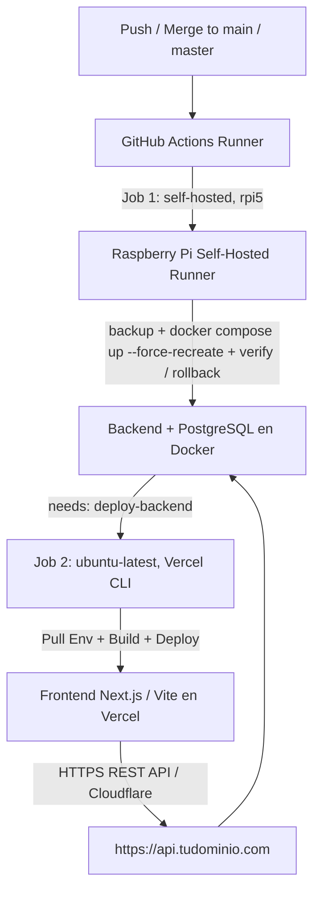

# Dual-Track CI/CD & Deployment Pipeline Runbook
> Production standard for automated monorepo deployment with **GitHub Actions**, **Vercel CLI** (Frontend), and **Raspberry Pi 5 Self-Hosted Runner** (Docker Compose Backend).

---

## 1. Pipeline Architecture

The monorepo uses a dual-track deployment triggered on pushes/merges to the production branch. The
backend goes first and the frontend is published only if the backend came up healthy (`needs:`):
a SPA pointing at a dead API is an outage with better looks.



---

## 2. Complete GitHub Actions Workflow (`.github/workflows/deploy.yml`)

Create `.github/workflows/deploy.yml` at the repository root:

```yaml
name: Production Deployment Pipeline

on:
  push:
    branches:
      - main
      - master
  workflow_dispatch:   # permite probar el pipeline contra la infra real sin tocar main/master

# Menor privilegio: el pipeline sólo necesita leer el repositorio.
permissions:
  contents: read

concurrency:
  group: production-deploy
  cancel-in-progress: false

env:
  # Tag inmutable por commit. Con `:latest` no existe imagen anterior a la que volver cuando
  # la verificación falla, y el rollback es imposible por construcción (§2.1).
  IMAGE_TAG: ${{ github.sha }}

jobs:
  # ==========================================
  # JOB 1: BACKEND DEPLOYMENT ON RASPBERRY PI
  # ==========================================
  deploy-backend:
    name: Deploy Backend on Raspberry Pi 5
    runs-on: [self-hosted, linux, rpi5]
    # Un job colgado en el runner self-hosted único bloquea a TODOS los proyectos del host
    # hasta el timeout por defecto (6 h). 30 min es holgado para un build ARM completo.
    timeout-minutes: 30
    steps:
      - name: Checkout repository
        uses: actions/checkout@v4

      # El .env vive SOLO en env-backups/<repo>/ y se copia en cada deploy: nunca se reutiliza
      # el del workspace (puede estar viejo) ni se cae a .env.example. Un .env de ejemplo en
      # produccion deja credenciales publicas (caso real: admin/admin + JWT_SECRET del repo).
      - name: Load production environment file (.env)
        env:
          ENV_STORE: /home/github-runner/env-backups/${{ github.event.repository.name }}/.env
          # Solo SUMA: ademas se exige toda *_PASSWORD / *_SECRET / *_KEY de .env.example que traiga
          # un valor de ejemplo. Una lista escrita a mano se desactualiza (asi se colo una clave
          # de base de ejemplo en produccion: la lista no la incluia).
          REQUIRED_SECRETS: "ADMIN_PASSWORD JWT_SECRET POSTGRES_PASSWORD"   # ajustar por proyecto
        run: |
          if [ ! -f "$ENV_STORE" ]; then
            echo "❌ No .env found for this repository."
            echo "   Expected at: $ENV_STORE"
            echo "   Create it once on the server (see §5.2). One command, it generates the secrets:"
            echo "     sudo bash $GITHUB_WORKSPACE/scripts/crear-env.sh"
            exit 1
          fi
          cp "$ENV_STORE" .env
          chmod 600 .env
          # Vacio, "admin" o igual al valor de .env.example = credencial de ejemplo en produccion.
          # Las derivadas solo cuentan si el ejemplo trae valor (una *_KEY opcional va vacia en el
          # ejemplo y no se exige); las NEXT_PUBLIC_* / VITE_* son publicas por definicion.
          derived=$(tr -d '\r' < .env.example | sed -n 's/^\([A-Za-z0-9_]*_\(PASSWORD\|SECRET\|KEY\)\)=..*/\1/p' | grep -v '^\(NEXT_PUBLIC\|VITE\)_' || true)
          for var in $(printf '%s\n' $REQUIRED_SECRETS $derived | sort -u); do
            value=$(grep -m1 "^${var}=" .env | cut -d= -f2-)
            example=$(grep -m1 "^${var}=" .env.example | cut -d= -f2- | tr -d '\r')
            if [ -z "$value" ] || [ "$value" = "admin" ] || [ "$value" = "$example" ]; then
              echo "❌ $var is empty or has an example value in $ENV_STORE"
              exit 1
            fi
          done
          echo "✅ .env loaded from $ENV_STORE (600)."

      # Antes de tocar nada: un puerto ya usado por otro proyecto aparece recien en el `up`
      # ("port is already allocated"), con el backup hecho y el contenedor viejo ya bajado.
      - name: Check host ports and backup schedule
        run: bash scripts/chequear-host.sh

      - name: Backup database before migrations
        run: |
          # El entrypoint corre migraciones al arrancar el contenedor: el respaldo va ANTES
          # del `up`, no después. Sin SSH ni transferencia de archivos, una migración mala
          # sin volcado previo es irreversible.
          set -a; . ./.env; set +a
          DB="${PROJECT_PREFIX:-app}-database"
          # Subcarpeta propia: el backup diario (scripts/backup.sh) comparte la raiz y su
          # rotacion es otra; si compartieran carpeta, `tail -n +8` borraria los diarios.
          BACKUP_DIR="/home/github-runner/backups/${{ github.event.repository.name }}/pre-deploy"
          mkdir -p "$BACKUP_DIR"
          if docker ps --format '{{.Names}}' | grep -qx "$DB"; then
            F="$BACKUP_DIR/$(date +%Y%m%d-%H%M%S)-${GITHUB_SHA::7}.sql.gz"
            # Sin `-t`: la TTY convierte LF en CRLF y corrompe el volcado.
            docker exec "$DB" pg_dump -U "$POSTGRES_USER" -d "$POSTGRES_DB" | gzip -9 > "$F"
            [ -s "$F" ] || { echo "❌ El volcado salió vacío; se aborta el despliegue."; exit 1; }
            echo "✅ Backup: $F ($(du -h "$F" | cut -f1))"
            # Retención: los últimos 7. En la SD del Pi, los volcados también llenan el disco.
            ls -1t "$BACKUP_DIR"/*.sql.gz | tail -n +8 | xargs -r rm --
          else
            echo "ℹ️ Primer despliegue: todavía no hay base que respaldar."
          fi

      - name: Record current version (rollback target)
        run: |
          LAST_GOOD_FILE="/home/github-runner/env-backups/${{ github.event.repository.name }}/last-good-tag"
          echo "PREVIOUS_TAG=$(cat "$LAST_GOOD_FILE" 2>/dev/null || echo '')" >> "$GITHUB_ENV"

      - name: Build & Deploy Docker Containers with Force Recreate
        run: |
          docker compose -f docker-compose.prod.yml up -d --build --force-recreate --remove-orphans

      - name: Verify deployment (rollback on failure)
        run: |
          set -a; . ./.env; set +a   # el shell del runner no tiene el .env cargado
          rollback() {
            if [ -z "$PREVIOUS_TAG" ]; then
              echo "❌ No hay versión previa registrada (primer despliegue)."
              echo "   El servicio queda caído y requiere intervención manual."
              exit 1
            fi
            PREV_IMG="${PROJECT_PREFIX:-app}-backend-prod:$PREVIOUS_TAG"
            if ! docker image inspect "$PREV_IMG" >/dev/null 2>&1; then
              echo "❌ La imagen previa $PREV_IMG ya no está en el host: no hay rollback posible."
              exit 1
            fi
            echo "↩️  Revirtiendo a $PREVIOUS_TAG"
            IMAGE_TAG="$PREVIOUS_TAG" docker compose -f docker-compose.prod.yml up -d --force-recreate
            echo "⚠️  Rollback aplicado: producción quedó en la versión anterior."
            echo "    El job falla igual — el commit desplegado no sirve."
            exit 1
          }
          docker compose -f docker-compose.prod.yml ps
          echo "==> Waiting for every service to report healthy..."
          for i in $(seq 1 30); do
            UNHEALTHY=$(docker compose -f docker-compose.prod.yml ps \
              --format '{{.Name}} {{.Health}}' | awk '$2 != "" && $2 != "healthy"')
            [ -z "$UNHEALTHY" ] && break
            sleep 5
          done
          if [ -n "$UNHEALTHY" ]; then
            echo "❌ Services never became healthy:"; echo "$UNHEALTHY"
            docker compose -f docker-compose.prod.yml logs --tail=80
            rollback
          fi
          echo "==> Smoke test against the health endpoint (contrato en §9)"
          # BACKEND_HOST_PORT y HEALTH_PATH son nombres del contrato (docker-compose-recipes.md
          # §0) y no se renombran por proyecto: es lo que permite que este YAML sea identico en
          # todos los repositorios. Un sinonimo cae al default y el smoke test prueba un puerto
          # o una ruta que no usa nadie, con el job saliendo verde (o rojo sobre un deploy sano).
          # BACKEND_PORT queda como respaldo solo para repos que ya lo publican con ese nombre
          # (el compose de esos repos usa el mismo anidado); un repo nuevo usa BACKEND_HOST_PORT.
          curl -fsS "http://localhost:${BACKEND_HOST_PORT:-${BACKEND_PORT:-3004}}${HEALTH_PATH:-/api/health}" \
            || { docker compose -f docker-compose.prod.yml logs --tail=80 backend; rollback; }
          echo "✅ Deployment verified."

      - name: Promote version & prune project images
        run: |
          set -a; . ./.env; set +a
          LAST_GOOD_FILE="/home/github-runner/env-backups/${{ github.event.repository.name }}/last-good-tag"
          echo "$IMAGE_TAG" > "$LAST_GOOD_FILE"
          # Host compartido: NUNCA `docker system prune`. Se poda sólo lo etiquetado como este
          # proyecto (build.labels, docker-compose-recipes.md §4.8). La imagen recién
          # promovida está en uso y nunca es candidata a poda.
          docker image prune -af \
            --filter "label=com.proyecto=${PROJECT_PREFIX:-app}" \
            --filter "until=720h"

      # La ruta publica del Tunnel la registra un script de root instalado UNA vez en el servidor
      # (§2.6), no un script del repo: sudoers lo permite solo a el, y no cambia con un push.
      - name: Register Cloudflare Tunnel route
        env:
          REPO_NAME: ${{ github.event.repository.name }}
        run: |
          if [ -x /usr/local/sbin/tunel-agregar ]; then
            sudo -n /usr/local/sbin/tunel-agregar "$REPO_NAME"
          else
            echo "ℹ️ Sin tunel-agregar en este servidor: la ruta del Tunnel va a mano (§3.1 Fase B)."
          fi

      # El cron vive versionado en scripts/crontab (plantilla: references/crontab): se
      # reemplazan solo las lineas de este proyecto en el crontab del usuario del runner y el
      # resto queda intacto. Va al final para que un deploy fallido (con rollback) no deje un
      # backup apuntando a contenedores que no existen. Ver §2.3.
      - name: Install project cron
        env:
          REPO_NAME: ${{ github.event.repository.name }}
        run: |
          mkdir -p "$HOME/backups/$REPO_NAME"
          { crontab -l 2>/dev/null | grep -v "$REPO_NAME" || true
            sed "s#__DIR__#$GITHUB_WORKSPACE#g" scripts/crontab; } | crontab -
          crontab -l | grep "$REPO_NAME"

  # ==========================================
  # JOB 2: FRONTEND DEPLOYMENT VIA VERCEL CLI
  # ==========================================
  deploy-frontend:
    name: Build & Deploy Frontend to Vercel
    runs-on: ubuntu-latest
    timeout-minutes: 15
    # El frontend no se publica si el backend no quedó sano: evita dejar una SPA en
    # producción apuntando a una API caída.
    needs: deploy-backend
    steps:
      - name: Checkout repository
        uses: actions/checkout@v4

      - name: Setup Node.js (Node 22 required for pnpm 10 / node:sqlite)
        uses: actions/setup-node@v4
        with:
          node-version: 22

      - name: Install pnpm & Vercel CLI
        run: npm install --global pnpm@latest vercel@latest

      - name: Pull Vercel Environment Information
        run: |
          vercel pull --yes --environment=production
          if [ -f .vercel/.env.production.local ]; then
            cp .vercel/.env.production.local apps/web/.env.production.local 2>/dev/null || cp .vercel/.env.production.local frontend/.env.production.local 2>/dev/null || true
          fi
        env:
          VERCEL_TOKEN: ${{ secrets.VERCEL_TOKEN }}
          VERCEL_ORG_ID: ${{ secrets.VERCEL_ORG_ID }}
          VERCEL_PROJECT_ID: ${{ secrets.VERCEL_PROJECT_ID }}

      - name: Build Project Artifacts
        run: vercel build --prod
        env:
          VERCEL_TOKEN: ${{ secrets.VERCEL_TOKEN }}
          VERCEL_ORG_ID: ${{ secrets.VERCEL_ORG_ID }}
          VERCEL_PROJECT_ID: ${{ secrets.VERCEL_PROJECT_ID }}
          NEXT_PUBLIC_API_URL: ${{ secrets.NEXT_PUBLIC_API_URL }}
          VITE_API_URL: ${{ secrets.VITE_API_URL || secrets.NEXT_PUBLIC_API_URL }}

      - name: Deploy Prebuilt Artifacts to Vercel
        run: vercel deploy --prebuilt --prod
        env:
          VERCEL_TOKEN: ${{ secrets.VERCEL_TOKEN }}
          VERCEL_ORG_ID: ${{ secrets.VERCEL_ORG_ID }}
          VERCEL_PROJECT_ID: ${{ secrets.VERCEL_PROJECT_ID }}
          NEXT_PUBLIC_API_URL: ${{ secrets.NEXT_PUBLIC_API_URL }}
          VITE_API_URL: ${{ secrets.VITE_API_URL || secrets.NEXT_PUBLIC_API_URL }}
```

> [!WARNING]
> Nombre de servicio (`backend`), prefijo (`PROJECT_PREFIX`) y fallback de puerto son placeholders —
> copiarlos tal cual del `.env`/compose reales del proyecto, no asumirlos. Y sin `healthcheck`
> nativo en el servicio (§4.6 de [`docker-compose-recipes.md`](./docker-compose-recipes.md)), el
> loop de espera no espera nada: falla por carrera, no por bug real.

> **Secretos siempre por `env:`, nunca dentro de `run:`.** Con `--token=${{ secrets.X }}` GitHub
> pega el valor en el texto del script *antes* de que el shell lo lea: una comilla, un `$` o un
> `|` en el secreto rompe el comando (o lo reinterpreta). Por `env:` llega como variable de
> entorno y el shell nunca lo parsea. La Vercel CLI lee `VERCEL_TOKEN` del entorno sola, por eso
> los pasos de arriba no llevan `--token`. En el resto de los pasos, el mismo criterio: valor en
> `env:`, y en el script `"$VARIABLE"` entre comillas.

> **Validaciones antes del deploy.** Si el repositorio tiene lint, tests o type-check, van en un
> job propio y los jobs de despliegue lo declaran en `needs:`. Un job de validación que corre en
> paralelo al deploy no protege nada: avisa cuando el commit roto ya está en producción.

### 2.1 Por qué el tag por commit no es opcional

Con `image: <proyecto>-backend-prod:latest`, cuando la verificación falla no hay a dónde volver:
la única imagen que existe es la que acaba de romper producción. El job queda rojo y **el
contenedor roto sigue sirviendo tráfico** — el peor de los dos mundos, porque nadie se entera
hasta que un usuario reclama.

Con un tag por commit, el rollback es re-levantar la etiqueta anterior. Las tres piezas:

| Pieza | Dónde vive | Para qué |
| :--- | :--- | :--- |
| `IMAGE_TAG: ${{ github.sha }}` | `env:` del workflow | Cada build produce una imagen distinguible |
| `image: ...:${IMAGE_TAG:-latest}` | `docker-compose.prod.yml` ([recetas de compose](./docker-compose-recipes.md) §4.3) | Levantar una versión concreta, no "la última" |
| `last-good-tag` | `env-backups/<repo>/` | Sobrevive entre corridas: el runner limpia el workspace en cada checkout |

El archivo `last-good-tag` **se escribe recién después de que la verificación pasa**. Un despliegue
fallido nunca se convierte en destino de rollback. Y la poda corre **después** de promover: podar
antes borraría justo la imagen anterior que el rollback necesita.

### 2.2 Respaldo previo y respaldo diario: dos carpetas

El respaldo previo a migrar vive en `backups/<repo>/pre-deploy/` (retención: los últimos 7). El
backup diario de [`backup.sh`](./backup.sh) usa la raíz `backups/<repo>/` con otra rotación
(`RETENTION_DAYS`). Si compartieran carpeta, el `tail -n +8` del deploy borraría los diarios.

### 2.3 Cron versionado: lo instala el deploy

El cron no se edita con `crontab -e`: vive en `scripts/crontab` del repo (plantilla:
[`crontab`](./crontab)) y el paso "Install project cron" lo instala en el crontab del usuario
del runner. Reemplaza solo las líneas que contienen el nombre del repo, así que las de otros
proyectos quedan intactas; por eso **toda línea del archivo debe contener el nombre del repo**
(basta con que lo lleve la ruta `__DIR__` o la del log). `__DIR__` lo cambia el deploy por la
carpeta real del workspace.

El horario del backup se escalona de a 10 minutos desde las 03:00 (un proyecto por franja) para
que dos `pg_dump` no corran a la vez en la Pi. Un deploy fallido no toca el cron (el paso va al
final).

### 2.4 Puertos y horarios: el servidor es el registro

> El panorama completo —también para la máquina de desarrollo— está en [`puertos.md`](./puertos.md).

No hay un archivo de registro escrito a mano, a propósito: se desactualiza, y los nombres de los
proyectos de un servidor no pertenecen a un repositorio público. La fuente de verdad es lo que el
host ya sabe (los puertos que publican los contenedores y el `crontab` del runner), y
[`chequear-host.sh`](./chequear-host.sh) (se copia a `scripts/`) lo consulta:

| Cuándo | Comando | Qué hace |
| :--- | :--- | :--- |
| **Cada deploy**, justo después de cargar el `.env` | `bash scripts/chequear-host.sh` | **Falla** si `BACKEND_HOST_PORT`, `DB_HOST_PORT` o `FRONTEND_HOST_PORT` ya los publica el contenedor de **otro** proyecto, figuran en el `.env` guardado de otro repo (aunque esté detenido) o los escucha un proceso ajeno (antes de bajar nada). **Avisa** (`::warning::`) si el backup de este repo cae a menos de 10 min del de otro |
| **Alta de un proyecto nuevo**, antes de crear el `.env` | `bash scripts/chequear-host.sh alta` | **Elige**: imprime puertos de backend, base y frontend libres, y el próximo horario de backup libre con la línea lista para `scripts/crontab` |
| **A demanda** | `docker ps --format 'table {{.Names}}\t{{.Ports}}'` y `crontab -l` | Ver el mapa completo (también en el catálogo de `inspecciona`, §6) |

"Otro proyecto" es todo contenedor cuyo nombre no empieza con `$PROJECT_PREFIX-`; por eso el
prefijo del contrato (`docker-compose-recipes.md` §0.1) es obligatorio. Un redeploy del mismo
proyecto no cuenta como conflicto: vuelve a tomar su propio puerto. El horario solo avisa y no
falla el deploy: un choque de minutos es una molestia, un puerto repetido es una caída.

### 2.5 Avisos de backup

Un backup que falla en silencio no es un backup (un proyecto estuvo meses sin
respaldo y nadie lo supo). Dos piezas, ambas en la plantilla de `crontab`:

- [`backup.sh`](./backup.sh) avisa si termina con error (o si falla solo la copia de archivos).
- [`verificar-backup.sh`](./verificar-backup.sh) corre cada día a las 09:00 y avisa si no hay un
  dump de menos de 36 h. Mira el **resultado**, no el proceso: es lo único que detecta un cron
  que nunca corre (ruta muerta, crontab sin instalar).

Ambos llaman a `/home/github-runner/avisar.sh`, **una copia por servidor** (no por repo), cuya
plantilla es [`avisar.sh`](./avisar.sh): manda el mensaje a un webhook cuya URL vive en
`/home/github-runner/avisar.env` (`AVISO_URL=...`, `600`, fuera de todo repo). Si el script no
existe, el aviso se reduce al log. Instalarlo una vez:

```bash
sudo install -o github-runner -g github-runner -m 700 avisar.sh /home/github-runner/avisar.sh
sudo install -o github-runner -g github-runner -m 600 /dev/null /home/github-runner/avisar.env
sudo nano /home/github-runner/avisar.env      # AVISO_URL=https://...
sudo -u github-runner /home/github-runner/avisar.sh "prueba de aviso"
```

### 2.6 Ruta del Tunnel: la registra el servidor, no el repo

Agregar `api-<repo>.<dominio>` al `config.yml` de `cloudflared` requiere `root`, y el deploy corre
como `github-runner`. La salida "obvia" —un `sudoers` que deje correr el `scripts/tunel.sh` del
repo— es **insegura**: quien pueda hacer push a ese repo edita el script y obtiene `root`. En su
lugar, [`tunel-agregar.sh`](./tunel-agregar.sh) se instala **una vez** en el servidor
(`/usr/local/sbin/tunel-agregar`, dueño `root`, fuera de todo repo) y el deploy solo le pasa el
**nombre del repo**:

- el dominio sale de `/etc/tunel-agregar.conf` (root), no del llamador;
- el puerto sale del `.env` del proyecto, y **tiene que estar publicado por un contenedor
  `<PROJECT_PREFIX>-*` en marcha** (no se enruta a un puerto cualquiera);
- el nombre es `api-<repo>.<dominio>`, salvo que el `.env` del proyecto en el servidor defina
  `TUNEL_HOST=<host completo>` (para un proyecto que **ya tenía** otra ruta pública). Se valida
  igual: minúsculas, termina en el `DOMINIO` de la configuración y **un solo nivel** debajo;
- solo toca entradas con su marcador `(tunel-agregar)`; las que escribiste a mano no se modifican
  ni se quitan;
- es idempotente: si la ruta ya está con el mismo puerto **no hace nada, ni reinicia** (el reinicio
  de `cloudflared` corta unos segundos a todos los proyectos);
- valida con `ingress validate` **antes** de reemplazar, guarda copia (`config.yml.bak-*`, las 10
  últimas) y, si `cloudflared` no queda activo tras reiniciar, **restaura** la copia.

> [!IMPORTANT]
> **Este paso es para proyectos nuevos o con ruta `api-<repo>`.** En un proyecto que ya tenía otra
> ruta, sin `TUNEL_HOST` el deploy crearía una ruta nueva + su CNAME y **reiniciaría `cloudflared`**
> (unos segundos sin servicio para todos). Dos formas seguras: definir `TUNEL_HOST` con la ruta
> real (si coincide con el config a mano y el puerto es el mismo, no hace nada ni reinicia; si el
> puerto difiere, falla y pide corregirlo a mano), o no poner el paso en ese `deploy.yml`.
> Además el script necesita `PROJECT_PREFIX` en el `.env` del servidor: sin él, el job queda rojo.

> [!NOTE]
> Honestidad sobre el alcance: `github-runner` ya pertenece al grupo `docker`, que equivale a
> `root` sobre ese host. Estas validaciones no son un límite contra un runner comprometido; son
> defensa en profundidad y evitan errores (puerto equivocado, entrada pisada). Lo que el diseño
> **sí** evita es sumar un camino a `root` a través de un archivo que cualquier push puede cambiar.

**Instalación, una vez por servidor** (el script se toma de la skill o de la copia que traiga el
workspace de cualquier repo; `cert.pem` es el certificado de `cloudflared tunnel login`):

```bash
sudo install -o root -g root -m 755 tunel-agregar.sh /usr/local/sbin/tunel-agregar
printf 'DOMINIO=<tu-dominio>\nTUNEL=<nombre-del-tunel>\nORIGINCERT=/home/<usuario>/.cloudflared/cert.pem\n' | sudo tee /etc/tunel-agregar.conf >/dev/null
echo 'github-runner ALL=(root) NOPASSWD: /usr/local/sbin/tunel-agregar' | sudo tee /etc/sudoers.d/tunel-agregar >/dev/null
sudo chmod 440 /etc/sudoers.d/tunel-agregar && sudo visudo -c
```

Antes de la primera ejecución, **comprobar sin cambiar nada** que tu `cloudflared` acepta el comando de
validación que usa el script, y que el contenedor publica el puerto:
`sudo cloudflared tunnel --config /etc/cloudflared/config.yml ingress validate` (debe decir `OK`).

Uso a mano (también para probar): `sudo tunel-agregar <repo>` y `sudo tunel-agregar --quitar <repo>`.
**Lanzarlo con `nohup` y el log en tu carpeta**, no en `/tmp`:
`sudo nohup tunel-agregar <repo> > ~/tunel.log 2>&1; cat ~/tunel.log`. Reiniciar `cloudflared` corta la
terminal web (si entrás por el propio Tunnel) y, sin `nohup`, el script podría morir después del
reinicio y antes de comprobar que quedó activo. Tras reconectar con Enter, `cat ~/tunel.log`.
(Probado en una prueba real que `setsid -f` dentro de `sudo bash -c` no llegó a ejecutar nada; no se
investigó la causa: usar `nohup`.)

**Verificado en un servidor real:** alta, idempotencia (la segunda corrida no reinicia), `--quitar`, y
el camino completo por el deploy (la ruta se quitó a propósito y el deploy la volvió a registrar sola:
de `404` a `200`), con el `sudo -n` del runner y la regla de `sudoers` de arriba.
Quitar una ruta **no borra el CNAME** de DNS (`cloudflared` no tiene un comando para eso): se borra
en el panel de Cloudflare. El primer `route dns` necesita el `cert.pem`; sin él, la ruta queda en el
`config.yml` y el script avisa que falta crear el CNAME.

---

## 3. Vercel CLI Strategy & Monorepo Gotchas

### Why Vercel CLI instead of Native Git Integration?
- **Hobby Plan Limitation**: Vercel blocks native Git repository linking when a repository is **both private and owned by a GitHub Organization** (it demands an upgrade to the Pro plan).
- **Zero-Cost Solution**: Deploying through **Vercel CLI in GitHub Actions** using a personal access token compiles and uploads directly via API with full monorepo support without organization upgrade restrictions.

### Required GitHub Secrets (`Settings > Secrets and variables > Actions`)
| Secret | Description | Where to obtain |
| :--- | :--- | :--- |
| `VERCEL_TOKEN` | Vercel Personal Access Token | Vercel Dashboard > *Account Settings > Tokens* |
| `VERCEL_PROJECT_ID` | Specific Project ID | Vercel Project > *Settings > General* |
| `VERCEL_ORG_ID` | Team / Personal Account ID | Vercel Project > *Settings > General* (or User Settings) |
| `NEXT_PUBLIC_API_URL` / `VITE_API_URL` | Public backend URL | e.g. `https://api-proyecto.tudominio.com` *(usar guion, no punto)* |
| `SITE_URL` | Frontend canonical URL | e.g. `https://proyecto.vercel.app` (requerido si prerenderiza Open Graph) |

> [!IMPORTANT]
> `VERCEL_TOKEN` y `VERCEL_ORG_ID` suelen ser constantes por cuenta/team — se guardan una vez (el
> token, en tu archivo de configuración personal; **no** como secret de organización, pitfall 14) y se
> reusan entre repos. `VERCEL_PROJECT_ID` y la URL pública son **por repositorio** — antes de
> cargar un `VERCEL_PROJECT_ID` guardado, confirmarlo contra `Settings → General → Project ID`
> del proyecto real (una cuenta puede tener varios proyectos; uno equivocado no da un error claro,
> falla el build con mensajes que parecen no tener relación). Revisar también que **Root
> Directory** y **Framework Preset** (dos campos separados en Vercel) apunten al subdirectorio y
> stack correctos, y confirmar la URL pública real con `curl`/`nslookup` en vez de asumirla.

### 3.1 Runbook de Onboarding para un Proyecto Nuevo (Paso a Paso)

Recorrido **probado de punta a punta** con un proyecto descartable (repo privado en la organización
del runner → Vercel Hobby → Raspberry Pi): transferencia, enlace de Vercel, secrets, `.env`,
respaldo previo, build en la Pi, healthcheck, smoke test y publicación del frontend. Lo único que
sigue siendo manual es lo que **no se puede** hacer desde el repo: los comandos en la Pi y la ruta
del Tunnel.

#### Una sola vez por máquina (no por proyecto)

| Qué | Cómo |
| :--- | :--- |
| `gh` con sesión | `gh auth login` |
| CLI de Vercel con sesión | `npx vercel login` (abre el navegador; no se instala nada global) |
| Un archivo de configuración personal, **fuera de todo repo** | `~/.config/alta-proyecto.env` con `ORG_RUNNER` (la organización dueña del runner), `DOMINIO` (tu dominio público) y `VERCEL_TOKEN`. El token se crea en [vercel.com/account/tokens](https://vercel.com/account/tokens) y es el mismo para todos los proyectos: así no se vuelve a pegar. El comando que lo crea pidiendo el token oculto está en la cabecera de [`alta-proyecto.sh`](./alta-proyecto.sh). Mejor un archivo que una variable de entorno de usuario: la variable la heredan todos los procesos que lanzás, el archivo solo lo lee el script |
| El script en el `PATH` | `cp alta-proyecto.sh ~/bin/alta-proyecto && chmod +x ~/bin/alta-proyecto` |

> [!WARNING]
> **No cargar `VERCEL_TOKEN` como secret de la organización.** En el plan Free de GitHub los secrets
> de organización **no llegan a los repos privados**: figuran en la lista y por API, pero el job los
> recibe vacíos (`VERCEL_TOKEN:` en blanco → *No existing credentials found*). Va a nivel repo, y
> `alta-proyecto.sh` lo carga solo desde tu archivo de configuración.

#### Fase A: Tu máquina de desarrollo

1. **Crear el repo directamente en la organización del runner**, sin hacer push todavía:
   ```bash
   gh repo create <org>/<repo> --private --source . --remote origin
   ```
   Un repo que nace en la cuenta personal también sirve (el script lo transfiere en el paso
   siguiente), pero **no hacer el primer push antes de transferir**: la corrida queda en cola sin
   runner y la transferencia la cancela. *(La prueba real se hizo con el camino de la
   transferencia; crear el repo directamente en la organización no se corrió, aunque es el
   comando estándar de `gh` y evita el paso.)*
2. **Puertos de desarrollo** (opcional, recomendado): `puerto asignar` en la carpeta del repo
   ([`puertos.md`](./puertos.md) §1).
3. **Correr el alta.** Empezar siempre por la simulación:
   ```bash
   alta-proyecto --simular      # imprime todo, no ejecuta nada
   alta-proyecto                # pide confirmación antes de cada paso que sale de tu máquina
   ```
   Hace, en orden: (1) pasa el repo a la organización si no está; (2) `vercel link` + fija el
   **Root Directory** del proyecto por `vercel api` (`link --yes` no lo hace y el build corre en la
   raíz del monorepo); (3) carga como secrets del repo `VERCEL_PROJECT_ID`, `VERCEL_ORG_ID`,
   `VERCEL_TOKEN`, `VITE_API_URL` y `SITE_URL`. Cada paso se puede correr suelto:
   `alta-proyecto --paso 2`.

   > Vercel imprime un **error 409** al enlazar ("repository is private and owned by an
   > organization, which is not supported on the Hobby plan"). Es esperado: el proyecto queda creado
   > y enlazado igual, porque se despliega con la CLI y no con la integración de Git (§3, arriba).
4. **Primer push**: `git push -u origin HEAD`. Falla **a propósito** en el paso del `.env`, pero el
   `checkout` deja el repo en el runner y el log imprime el comando del paso siguiente.

#### Fase B: El servidor (Raspberry Pi 5)

1. **NO clonar el repositorio en `~/Documents`**: el runner autogestiona el workspace en
   `/home/github-runner/actions-runner/_work/<repo>/<repo>`. Clonar a mano duplica código y gasta
   la tarjeta SD.
2. **Crear el `.env` de producción** con un solo comando (funciona desde cualquier carpeta):
   ```bash
   sudo bash /home/github-runner/actions-runner/_work/<repo>/<repo>/scripts/crear-env.sh
   ```
   Genera `JWT_SECRET` y toda `*_PASSWORD` vacía en `.env.example`, **asigna puertos libres** a las
   `*_HOST_PORT` que están vacías en la plantilla (los mismos que `chequear-host.sh alta`),
   y deja el archivo en `env-backups/<repo>/.env` (`600`, dueño `github-runner`). Lista lo que falta
   completar a mano (API keys). Anotar el puerto asignado:
   `sudo grep BACKEND_HOST_PORT /home/github-runner/env-backups/<repo>/.env`.

   > [!WARNING]
   > Para editar el `.env` después, `sudo nano` y luego
   > `sudo chown github-runner:github-runner <ruta>`. **No usar `sudo sed -i`**: recrea el archivo
   > como `root` y el runner deja de poder leerlo.
   >
   > Si el proyecto ya tiene base, el `POSTGRES_PASSWORD` real se copia a mano antes: la base ya
   > fue creada con esa clave.
3. **Horario del backup**: si el repo trae `scripts/crontab`, elegir la franja libre con
   `sudo -u github-runner bash …/scripts/chequear-host.sh libre` y ponerla en la línea del crontab
   ([`puertos.md`](./puertos.md) §2).
4. **Ruta del Tunnel para el Backend.** Si el servidor tiene `tunel-agregar` instalado (§2.6), **el
   deploy la registra solo** (paso "Register Cloudflare Tunnel route", con el puerto del `.env`) y
   no hay nada que hacer (si la ruta pública ya existía con otro nombre, agregar `TUNEL_HOST` al
   `.env` del servidor: §2.6). A mano, solo en un servidor sin él:
   En `/etc/cloudflared/config.yml` (o Zero Trust Dashboard), agregar la regla de ingress:
   ```yaml
   - hostname: api-<proyecto>.<dominio>
     service: http://localhost:<BACKEND_HOST_PORT>
   ```
   > [!WARNING]
   > Usar SIEMPRE guion (`api-<proyecto>`), nunca dos puntos (`api.<proyecto>`). Cloudflare Universal SSL gratuito sólo cubre un nivel de comodín (`*.<dominio>`); dos puntos causan fallo fatal de handshake TLS (`SEC_E_ILLEGAL_MESSAGE`).

   Enrutar el DNS y reiniciar el servicio:
   ```bash
   # Si no recuerdas el nombre de tu túnel activo en la Raspberry Pi:
   cloudflared tunnel list

   # Enrutar el DNS y reiniciar el servicio:
   cloudflared tunnel route dns <NOMBRE_TUNEL> api-<proyecto>.<dominio>
   sudo systemctl restart cloudflared
   ```
   *(Nota: si estás conectado por la terminal web `terminal.<dominio>`, la conexión WebSocket se cortará por 2 segundos arrojando "Press enter to reconnect". Basta con presionar Enter para reconectar)*.

#### Fase C: Disparar el Despliegue

Desde la máquina de desarrollo, con `gh` (no hace falta otro push):
```bash
gh workflow run deploy.yml --ref <rama> && gh run watch
```
La Pi carga el `.env`, verifica los puertos, respalda la base si existe, construye y levanta Docker,
espera `healthy` y corre el smoke test (con rollback si falla). Después se publica el frontend en
Vercel. Confirmar con `curl https://api-<proyecto>.<dominio>/api/health` (la versión que devuelve
es la del commit, §8).

### 3.2 Runbook: Migrar un Proyecto Existente a la Plantilla

§3.1 es para un proyecto nuevo. Un proyecto que **ya corre en producción** tiene tres riesgos
que el nuevo no tiene: un `.env` en el servidor con nombres viejos, una ruta pública que ya existe
y usuarios conectados. Recorrido aplicado a siete repos de un mismo servidor, sin cortar ninguno.

**Orden: de menor a mayor riesgo.** Empezar por el proyecto con menos usuarios y más fácil de
reponer; dejar para el final el que no admite caída. Cada uno enseña algo para el siguiente.

**Por proyecto:**

1. **Rama de trabajo** `fix/ops-<tema>` (nunca directo a producción) y un solo PR por proyecto.
2. Traer la plantilla: `chequear-host.sh`, backup previo, tag por commit con rollback,
   `verificar-backup.sh` en el `scripts/crontab`, puertos de contenedor en `127.0.0.1`.
3. Aplicar los puentes de «`.env` del servidor con nombres viejos» (abajo) **antes** del merge.
4. Merge del PR: esto despliega. Seguir la corrida **del commit de merge**, no «la última de la
   lista» (puede ser una corrida vieja, verde o roja, de otro commit):
   ```bash
   gh run list --workflow=deploy.yml --branch main --limit 3      # buscar el commit del merge
   gh run watch <id-de-esa-corrida> --exit-status
   ```
5. Comprobar la **URL pública** (`curl -fsS https://api-<proyecto>.<dominio>/<HEALTH_PATH>`),
   no solo el job verde: es lo que ve el usuario (§8).
6. Recién con ese proyecto sano, pasar al siguiente.

**El primer deploy migrado no tiene rollback.** `last-good-tag` todavía no existe: si la
verificación falla, el servicio queda caído y se arregla a mano (§2.1). Hacerlo en horario de poca
actividad, con el backup manual hecho y a la vista. El rollback queda armado desde el segundo deploy.

**Cambiar el nombre de la imagen deja la vieja huérfana.** La poda borra solo imágenes con la
etiqueta del proyecto; la imagen con el nombre anterior no la tiene y se queda ocupando disco.
Después de verificar el deploy: `docker images` y `docker rmi <imagen-vieja>` a mano.

**`.env` del servidor sin `PROJECT_PREFIX` o con nombres viejos.** El `.env` de producción no se
toca con un push, así que la plantilla tiene que convivir con él hasta que se actualice:

- En el workflow, un puente: `env: PROJECT_PREFIX: <prefijo>` en los pasos que lo necesitan y
  `PORT_VARS: "BACKEND_PORT DB_PORT"` para que `chequear-host.sh` mire las variables viejas.
- En el compose, `${NUEVO:-${VIEJO}}` (p. ej. `${BACKEND_HOST_PORT:-${BACKEND_PORT}}`) para que
  levante con cualquiera de los dos nombres.
- Con el proyecto ya sano, agregar al `.env` del servidor los nombres nuevos **conservando dueño y
  permisos** (`sudo -u github-runner` en el comando que lo edita; con `sudo nano` o `sudo tee` el
  archivo pasa a `root` y el runner deja de poder leerlo). Con los nombres nuevos en su lugar,
  quitar los puentes en un segundo PR.

**`127.0.0.1` tiene excepciones.** El estándar ata a `127.0.0.1` todo lo que no sea el túnel, pero un
servicio que se usa **a propósito** desde la red local (un atajo del celular que llama a un
puerto de la Pi) queda en `0.0.0.0`. Leer el README del proyecto antes de atarlo, y si queda
abierto, que tenga un secreto propio (`*_SECRET`) en vez de depender de la red.

**Un backend sin `/health`.** Si la API no tiene un endpoint de salud, no inventarlo en la
migración: apuntar `HEALTH_PATH`, el `healthcheck` y el smoke test a una **ruta pública que
responda** (la raíz) y anotar en `PENDIENTES` que falta el endpoint (contrato, §9). Con la raíz
solo se prueba que el proceso atiende, no que llegue a la base.

**Instalar un archivo en el servidor desde una terminal web** (sin SSH ni copiar archivos): codificar
en la máquina de desarrollo y pegar **una línea**:

```bash
# máquina de desarrollo
base64 -w0 scripts/avisar.sh        # (macOS: base64 -i scripts/avisar.sh)
# servidor: pegar el resultado entre las comillas
echo '<base64>' | base64 -d | sudo install -o github-runner -g github-runner -m 755 /dev/stdin /home/github-runner/avisar.sh
```

`install` crea el archivo con dueño y permiso en un solo paso: no queda una ventana con el archivo
legible por otros. Para un `.env` o cualquier cosa con secretos, `-m 600`.

---

## 4. Critical Deployment Pitfalls & Applied Solutions

### 1. `NEXT_PUBLIC_*` Build-Time Ingestion (Error 404 on Auth / Login)
- **Problem**: Next.js bakes `NEXT_PUBLIC_*` variables into the static browser bundle at **build time**. When building from monorepo root via Vercel CLI, if `NEXT_PUBLIC_API_URL` is omitted in the CI step, the client defaults to relative paths on the Vercel domain (`https://app.vercel.app/auth/login` -> 404 Not Found).
- **Solution**: Pass `NEXT_PUBLIC_API_URL` explicitly in the `env` blocks of both `vercel build` and `vercel deploy`, and copy `.vercel/.env.production.local` to `apps/web/.env.production.local`.

### 2. Monorepo Root Duplication (`apps/web/apps/web/package.json ENOENT`)
- **Problem**: `Error: ENOENT: no such file or directory, open '.../apps/web/apps/web/package.json'`.
- **Causa**: Vercel project already configured `Root Directory: apps/web`. Adding `working-directory: ./apps/web` in GitHub Actions causes the CLI to duplicate the path.
- **Solution**: Run all Vercel CLI commands strictly from the **monorepo root** without `working-directory`.

### 3. Node.js 22 & pnpm 10 Compatibility (`node:sqlite`)
- **Problem**: `spawn pnpm ENOENT` or `ERR_UNKNOWN_BUILTIN_MODULE: No such built-in module: node:sqlite`.
- **Causa**: pnpm v10+ uses the native `node:sqlite` built-in module, which requires Node.js v22.13+.
- **Solution**: Always configure `actions/setup-node@v4` with `node-version: 22`.

### 4. Production Database Seeder Execution
- **Problem**: In production images where `devDependencies` are pruned, `ts-node` is missing and `prisma/seed.ts` fails silently or crashes the entrypoint.
- **Solution**:
  1. In the Dockerfile build stage, compile the seeder with **its own** `tsc` invocation and
     `outDir` — y **sin `|| true`**: un seeder que no compila tiene que romper el build, no
     producir una imagen a la que le falta un archivo
     (`RUN if [ -f prisma/seed.ts ]; then npx --no-install tsc prisma/seed.ts --outDir dist/prisma --target ES2022 --module CommonJS; fi`).
  2. In `entrypoint.sh`, pick the compiled JS with an `if`/`elif` — no con una cadena de
     `||` que termina en `true` y se traga cualquier error de ejecución
     ([`database-lifecycle.md`](./database-lifecycle.md) §1).
  3. Ensure `ADMIN_USERNAME` and `ADMIN_PASSWORD` in `seed.ts` are read strictly from `process.env` (throw an error if not present, never fallback to known insecure defaults).
  4. Keep `prisma` in `dependencies`: `npm ci --omit=dev` rebuilds `node_modules` from scratch,
     so the generated client must be produced **after** the prune
     ([`dockerfile-recipes.md`](./dockerfile-recipes.md) §2).

### 5. Multi-line YAML Heredoc Syntax Errors (`wanted 'EOF'`)
- **Problem**: `Invalid workflow file: warning: here-document delimited by end-of-file (wanted 'EOF')`.
- **Causa**: Indented Bash heredocs (`cat << 'EOF'`) inside YAML `run: |` blocks fail parsing because indentation clashes with YAML block boundaries.
- **Solution**: Avoid heredocs in YAML; use simple shell commands (`cp "$ENV_STORE" .env`, `echo ...`).

### 6. Container & State Refresh (`--force-recreate`)
- **Problem**: Code or `.env` changes on Raspberry Pi are not picked up if Docker thinks image layers haven't changed.
- **Solution**: Always deploy with:
  ```bash
  docker compose -f docker-compose.prod.yml up -d --build --force-recreate --remove-orphans
  ```

### 7. Dev and Prod Building to the Same Image Name
- **Problem**: Production comes up running the development image — dev server instead of the static/compiled server, or a container that answers nothing.
- **Causa**: Both compose files build to the same default image name (`<project>-backend`). Without `--build`, Compose reuses whatever image already carries that tag.
- **Solution**: recipe in `docker-compose-recipes.md` §4.3. Always deploy with `--build --force-recreate`.

### 8. Environment Variables Are Frozen at Container Creation
- **Problem**: `.env` is edited on the server, the container is restarted, and the old value is still in effect.
- **Causa**: see `database-lifecycle.md` §0 — a container's environment is frozen at creation time.
- **Solution**: Re-create the container: `docker compose -f docker-compose.prod.yml up -d --force-recreate <service>`. Confirm with `docker exec <container> printenv <VAR>`.

### 9. `.env` Is Never Updated by `git pull`
- **Problem**: A variable is changed in `.env.example`, merged and deployed — and production keeps the old value.
- **Causa**: `.env` is git-ignored, so it only exists on the server and no deploy ever rewrites it. Only the tracked `.env.example` moves.
- **Solution**: Any change to `.env.example` carries a manual step on the server: edit `.env`, re-create the container (§8), and copy the file back to the per-repository store (§5.2). Never let the workflow "fix" it by falling back to the template.

### 10. `pg_isready` Missing from the Image (Deploy Hangs, Then Blames the Database)
- **Problem**: el job levanta los contenedores, el backend nunca pasa a `healthy` y el log dice
  `Database not ready yet (30/30)`. La base está perfectamente arriba.
- **Causa**: `node:22-alpine` y `python:3.12-slim` no traen `pg_isready`. El `until` del
  entrypoint interpreta "comando inexistente" (exit 127) como "base no lista" y agota los
  reintentos.
- **Solution**: instalar `postgresql-client` en la etapa `base` del Dockerfile
  ([`dockerfile-recipes.md`](./dockerfile-recipes.md) §8.3) y usar el entrypoint de
  [`database-lifecycle.md`](./database-lifecycle.md) §1, que verifica el binario **antes** del
  loop y aborta con un mensaje que dice lo que realmente pasa.

### 11. Healthcheck Contra `localhost` Dentro del Contenedor (Deploy Rojo con la App Sana)
- **Problem**: el smoke test pasa, `curl` desde el host devuelve 200 — y el contenedor queda
  `unhealthy` para siempre, así que el paso de verificación falla el job en cada deploy.
- **Causa**: dentro del contenedor `localhost` resuelve a `::1`. Una app que escucha en `0.0.0.0`
  escucha en IPv4: el healthcheck se conecta por IPv6 y recibe `connection refused`.
- **Solution**: `127.0.0.1` en el `healthcheck` del compose
  ([`docker-compose-recipes.md`](./docker-compose-recipes.md) §4.7). El smoke test del workflow,
  que corre en el host, sí puede usar `localhost`.
- **Cómo confirmarlo**: `docker inspect <contenedor> --format '{{json .State.Health}}'` — el
  campo `Output` trae el error exacto de cada intento.

### 12. `git push` No Dispara Actions en Repos Privados de Organización (Falla Silenciosa)
- **Problem**: hacés `git push origin main/master`, la terminal confirma la subida, pero en Actions no
  se crea ninguna corrida (`gh run list` no muestra nada y `actions/runs?event=push` devuelve 0).
- **Causa**: en repositorios privados bajo organizaciones, el webhook interno que enlaza los eventos
  `push` con Actions a veces queda inactivo o desincronizado al crearse o transferirse el repo.
- **Bypass operativo inmediato**: no esperar al webhook; disparar el workflow a mano:
  ```bash
  gh workflow run deploy.yml --ref <rama>
  ```
- **Solución definitiva**: forzar a GitHub a reenganchar los detectores de eventos refrescando
  los permisos de Actions del repositorio vía CLI:
  ```bash
  gh api -X PUT repos/<owner>/<repo>/actions/permissions -F enabled=true -F allowed_actions=all
  ```

### 13. Caché Negativa de DNS Local tras Enrutar el Túnel (`Could not resolve host`)
- **Problem**: Inmediatamente tras ejecutar `cloudflared tunnel route dns` y reiniciar cloudflared, probar `curl https://api-<proyecto>.<dominio>/api/health` arroja `curl: (6) Could not resolve host`.
- **Causa**: Si se intentó consultar el dominio antes o durante la creación de la ruta DNS, el resolver local (router del ISP o caché del sistema operativo) guardó en memoria la respuesta negativa (NXDOMAIN).
- **Bypass / Validación inmediata**: Consultar mediante DNS sobre HTTPS (DoH) de Cloudflare o directamente al servidor `1.1.1.1`, saltando la caché del router local:
  ```bash
  # En Windows / PowerShell (forzando resolución DoH directa a Cloudflare):
  curl.exe --doh-url https://cloudflare-dns.com/dns-query -fsS https://api-<proyecto>.<dominio>/api/health

  # Verificar resolución pública en Cloudflare:
  Resolve-DnsName api-<proyecto>.<dominio> -Server 1.1.1.1
  ```
- **Solución**: Limpiar la caché local de DNS (`ipconfig /flushdns` en Windows) o esperar de 2 a 5 minutos a que expire el TTL del router local.

### 14. Secret de Organización Vacío en Repos Privados (Plan Free)
- **Problem**: el job del frontend falla con "Error: No existing credentials found. Please run
  vercel login or pass --token", y en el log del paso aparece `VERCEL_TOKEN:` en blanco.
- **Causa**: el token se cargó como secret **de la organización** (`gh secret set --org`). En el plan
  Free de GitHub esos secrets no se entregan a repos privados: `gh secret list --org` y la API del
  repo (`actions/organization-secrets`) lo muestran como disponible, pero el job lo recibe vacío. No
  hay ningún error que lo explique.
- **Solution**: cargarlo a nivel repo (`gh secret set VERCEL_TOKEN --repo <org>/<repo>`). Para no
  repetir el paso en cada proyecto, [`alta-proyecto.sh`](./alta-proyecto.sh) lo toma de tu archivo
  de configuración personal (§3.1).
- **Cómo confirmarlo**: `gh run view <id> --log` del paso que falla; `VERCEL_TOKEN:` sin valor.

### 15. Primer Push Antes de Transferir el Repo (Corrida en Cola, Luego Cancelada)
- **Problem**: tras subir el código a un repo personal aparece una corrida `queued` que nadie toma
  y, al transferir el repo a la organización, queda `cancelled`.
- **Causa**: el workflow pide `runs-on: [self-hosted, ...]` y el runner es de la organización
  (§5.1): un repo personal no lo ve. Transferir cancela lo que está en vuelo.
- **Solution**: crear el repo directamente en la organización
  (`gh repo create <org>/<repo> --private …`) o transferirlo **antes** del primer push (§3.1).

### 16. `gh api /ruta` Falla en Git Bash (Windows)
- **Problem**: `invalid API endpoint: "C:/Program Files/Git/orgs/…"`.
- **Causa**: Git Bash convierte los argumentos que empiezan con `/` en rutas de archivo de Windows.
- **Solution**: omitir la barra inicial (`gh api orgs/<org>/actions/runners`) o anteponer
  `MSYS_NO_PATHCONV=1` al comando. Vale igual para `vercel api /v9/…`.

---

## 5. Self-Hosted Runner — Alcance, Entorno y Host Compartido

### 5.1 El runner vive en la organización, no en la cuenta personal

Cuando el runner está registrado **a nivel organización**, un repositorio que nace en la cuenta
personal **no lo ve**: el job queda en `Queued` indefinidamente y no hay mensaje de error.

- **Antes del primer deploy, el repositorio tiene que estar bajo la organización.** Si nació
  personal: *Settings → General → Danger Zone → Transfer ownership*.
- Con el runner group en "All repositories", un repo recién transferido queda cubierto solo. Si
  está restringido a una lista, agregarlo a mano (*Org Settings → Actions → Runner groups*).

### 5.2 Un archivo de entorno por repositorio

El servidor guarda los `.env` productivos fuera del workspace (que `actions/checkout` limpia en
cada corrida). **Con más de un proyecto en el mismo host, un archivo único no alcanza:** el
primer repositorio se lo queda y el resto lee credenciales ajenas o pisa las suyas.

```
/home/github-runner/env-backups/
├── <repo-a>/.env      # 600, owner github-runner
├── <repo-b>/.env
└── <repo-c>/.env
```

Alta de un proyecto nuevo (una sola vez, en el servidor): `sudo bash scripts/crear-env.sh`
(plantilla en [`crear-env.sh`](./crear-env.sh); cada repo la copia a `scripts/`). Para migrar un
`.env` que ya existe, a mano:

```bash
REPO=<nombre-del-repo>
sudo install -d -o github-runner -g github-runner -m 700 /home/github-runner/env-backups/$REPO
sudo install -o github-runner -g github-runner -m 600 \
  /home/<usuario>/Documents/$REPO/.env /home/github-runner/env-backups/$REPO/.env
sudo ls -l /home/github-runner/env-backups/$REPO/.env
sudo wc -l /home/github-runner/env-backups/$REPO/.env
```

> [!NOTE]
> Verificar siempre con `sudo` — un `ls`/`cat` normal da "Permission denied" a propósito (§5.4),
> no es un error.

El workflow deriva la ruta de `${{ github.event.repository.name }}`, así que el YAML es idéntico
en todos los proyectos y no hay nada que editar por repo.

**Rotar secretos** (`JWT_SECRET`, clave de la base): `sudo bash scripts/rotar-secretos.sh {jwt|db|all}`
(plantilla en [`rotar-secretos.sh`](./rotar-secretos.sh)). Prepara el `.env` nuevo aparte, hace el
`ALTER USER` primero y recién si funcionó reemplaza el `.env` — al revés, un fallo en el medio deja
al backend afuera de su propia base. No imprime secretos ni reinicia nada: después hay que volver
a correr el deploy. Rotar `JWT_SECRET` cierra todas las sesiones abiertas.

La base se busca en el contenedor `DB_CONTAINER_NAME` del `.env` o, si no está, en
`<PROJECT_PREFIX>-database`. Si el `.env` no trae ninguno de los dos, el script **avisa el motivo y
no toca nada** (no adivina un nombre genérico).

**Paso a paso para rotar la clave de la base** (probado en producción):

1. **Backup manual** con el `backup.sh` del proyecto y confirmar que el archivo no está vacío.
2. **Prefijo**: que el `.env` del servidor tenga `PROJECT_PREFIX` (o `DB_CONTAINER_NAME`).
3. `sudo bash scripts/rotar-secretos.sh db`.
4. **Deploy inmediato** (`gh workflow run deploy.yml --ref <rama>`): hasta entonces el backend en
   marcha no puede abrir conexiones nuevas.
5. **`/health` con la base**: que responda 200 y reporte la base como conectada.
6. Recién ahí, sumar la variable a `REQUIRED_SECRETS` del deploy (si la lista es manual).
7. Borrar el `.env.bak-*` (guarda la clave anterior en texto plano).

> **Migración desde el layout viejo** (un `.env` suelto en `env-backups/`): mover el archivo a su
> carpeta, desplegar una vez para confirmar, y recién ahí borrar el original.

### 5.3 Host compartido: reglas de convivencia

El servidor hospeda varios proyectos simultáneos, con contenedores de todos ellos.

| Prohibido | Por qué |
| :--- | :--- |
| `docker system prune` / `docker container prune` | Se lleva contenedores e imágenes de los otros proyectos |
| `docker compose down` sin `-f docker-compose.prod.yml` desde el directorio del proyecto | Actúa sobre lo que Compose crea que es "el proyecto actual" |
| Reusar puertos sin verificar | Colisión silenciosa con otro proyecto ya desplegado |

Antes de asignar los puertos de un proyecto nuevo:

```bash
docker ps --format 'table {{.Names}}\t{{.Ports}}'
```

### 5.4 Aislamiento y permisos

1. El runner aísla el workspace en `/home/github-runner/actions-runner/_work/<repo>/<repo>/`.
2. `chmod 600 .env` — solo el usuario del runner lee los secretos.
3. **No hacen falta secretos de SSH** (`RASPI_HOST`, `RASPI_SSH_KEY`, `RASPI_USER`): el runner ya
   corre dentro del servidor.

---

## 6. Catálogo de Diagnóstico (*modo `inspecciona`*)

Comandos **exclusivamente de lectura**, para ejecutar en el servidor y responder "¿en qué estado
está producción realmente?" antes de proponer cualquier cambio. Ninguno modifica nada, así que se
pueden pegar sin riesgo — también en una terminal web sin SSH.

### 6.0 Antes que nada: ¿el pipeline llegó a correr alguna vez?

Todo corre desde la máquina de desarrollo, con `gh`. **Si nunca hubo un deploy exitoso, no hay
nada desplegado que inspeccionar** y el resto del catálogo es ruido.

```bash
gh repo view --json nameWithOwner,isPrivate --jq '.'      # ¿esta bajo la organizacion? (§5.1)
gh run list --limit 10                                     # ¿alguna verde?
gh secret list                                             # ¿estan cargados los secrets?
gh api repos/<owner>/<repo>/actions/runners --jq '.runners[]?'   # ¿ve algun runner?
gh api "repos/<owner>/<repo>/actions/runs?event=push" --jq '.total_count' # ¿el push dispara eventos o esta dormido? (§4.12)
```

**Cómo se ve un runner que nunca levanta el job:** corridas en `cancelled` con `startedAt` y
`completedAt` separados por **exactamente 24 h** — el timeout con que GitHub mata un job que
quedó en `Queued`. No hay ningún mensaje de error que lo explique.

```bash
gh run view <id> --json jobs \
  --jq '.jobs[] | "\(.status)/\(.conclusion)  \(.startedAt) → \(.completedAt)"'
```

Las dos causas, ambas silenciosas: el repositorio **no está bajo la organización** dueña del
runner (§5.1), o las **etiquetas del `runs-on` no coinciden** con las del runner real.

### 6.1 Inventario real del host

```bash
# TODOS los contenedores del host, incluidos los detenidos y los de otros proyectos.
# Nunca alcanza con `docker compose ps`: Compose sólo lista lo que reconoce como suyo
# (por labels, no por nombre), y deja invisibles a los huérfanos de versiones anteriores.
docker ps -a --format 'table {{.Names}}\t{{.Status}}\t{{.Image}}\t{{.Ports}}'
```

### 6.2 Salud y recursos del proyecto

```bash
docker compose -f docker-compose.prod.yml ps
docker inspect --format '{{.Name}} → {{.State.Health.Status}}' $(docker compose -f docker-compose.prod.yml ps -q)
docker stats --no-stream
df -h /
docker system df
```

### 6.3 Qué está corriendo de verdad

```bash
# Versión desplegada (ver §8), edad de la imagen y variables efectivas DENTRO del contenedor
# — que es lo único que manda, no lo que diga el .env del repo.
curl -fsS http://localhost:<puerto><HEALTH_PATH>   # contrato en §9
docker inspect --format '{{.Config.Image}} creado {{.Created}}' <contenedor>
docker exec <contenedor> printenv <VAR_1> <VAR_2>
```

### 6.4 Logs

```bash
docker compose -f docker-compose.prod.yml logs --tail=80
docker logs --tail=80 --since 30m <contenedor>
```

### 6.5 Credenciales de ejemplo en producción

Un `.env` de producción con la contraseña o el secreto de `.env.example` deja credenciales
públicas (el repo es legible): pasó con `ADMIN_PASSWORD` y `JWT_SECRET`. Compara **cada**
variable `*_PASSWORD` / `*_SECRET` contra la plantilla y **no imprime ningún valor**, solo el
veredicto. Una línea por repo (reemplazar `<repo>`; el workspace tiene el `.env.example` del
último deploy):

```bash
sudo awk -F= 'BEGIN{q=sprintf("%c",39)} function val(l){sub(/^[^=]*=/,"",l);gsub("^[\"" q "]|[\"" q "]$","",l);return l} FNR==NR{if($1~/(_SECRET|_PASSWORD)$/)ej[$1]=val($0);next} ($1 in ej){v=val($0);print $1, (v==""?"VACIO":(v=="admin"||v==ej[$1])?"EJEMPLO":"OK")}' /home/github-runner/actions-runner/_work/<repo>/<repo>/.env.example /home/github-runner/env-backups/<repo>/.env
```

Salida esperada: `OK` en todas. `EJEMPLO` (igual a la plantilla, o `admin`) es un hallazgo
**crítico**: rotarla con [`rotar-secretos.sh`](./rotar-secretos.sh) (§5.2). `VACIO` en una
variable obligatoria también; en una API key opcional, no.

### 6.6 Cron versionado: ¿las rutas existen?

El backup puede fallar en silencio durante meses si el cron apunta a un lugar que no existe
(caso real: `/home/pi/...`, un usuario que nunca estuvo en el servidor). Lista cada ruta del
`crontab` del usuario del runner y dice si existe (para los `.log`, si existe su carpeta):

```bash
sudo -u github-runner bash -c 'crontab -l | grep -v "^[[:space:]]*#" | grep -o "[^ ]*/[^ ]*" | sed "s#^\$HOME#$HOME#;s#^~#$HOME#" | sort -u | while read -r p; do case "$p" in *.log) p=$(dirname "$p");; esac; if [ -e "$p" ]; then echo "OK     $p"; else echo "MUERTA $p"; fi; done'
```

Salida esperada: todo `OK`. Cualquier `MUERTA` es un backup que no está corriendo. Dos
complementos: que `crontab -l` tenga una línea por proyecto (si falta una, el deploy nunca
instaló el cron, §2.3) y que el último archivo de `~/backups/<repo>/` tenga menos de ~36 h (lo
mismo que vigila `verificar-backup.sh` a diario, §2.3, pero acá a demanda):

```bash
sudo -u github-runner bash -c 'for d in $HOME/backups/*/; do echo "$d  $(find "$d" -maxdepth 1 -name "db_*.sql.gz" -mmin -2160 | wc -l) recientes"; done'
```

`0 recientes` en un proyecto con cron instalado = el backup se atrasó o está fallando (el
motivo está en su `backup.log`).

### 6.7 `.env` sueltos y carpetas fuera de convención

El almacén tiene que ser exactamente `env-backups/<repo>/.env` (más `last-good-tag` y las copias
`.env.bak-*` de `rotar-secretos.sh`). Un `.env` en la raíz del almacén es del layout viejo y
nadie lo lee: puede estar desactualizado y llevar credenciales vivas.

```bash
sudo find /home/github-runner/env-backups -maxdepth 1 -type f                       # sueltos en la raíz
sudo find /home/github-runner/env-backups -mindepth 2 -type f ! -name .env ! -name last-good-tag ! -name '.env.bak-*'   # archivos raros dentro de una carpeta
sudo bash -c 'for d in /home/github-runner/env-backups/*/; do [ -f "${d}.env" ] || echo "sin .env: $d"; done'            # carpeta sin .env
diff <(sudo ls /home/github-runner/env-backups) <(sudo ls /home/github-runner/actions-runner/_work | grep -v "^_")   # < env sin repo   > repo sin env
```

Salida esperada: vacía en las tres primeras. En el `diff`, `<` es un `.env` de un repo que ya
no se despliega (candidato a archivar) y `>` un repo que corre sin `.env` propio. Borrar un
suelto se propone **después** de confirmar que su carpeta tiene un `.env` vigente (§5.2).

### 6.8 Reglas del modo

1. **Solo lectura.** Nada de `up`, `down`, `restart`, `rm`, `prune` ni escrituras en la base.
2. **Comandos de una sola línea**, pegables en una terminal web, con la salida esperada indicada.
3. Lo que aparezca para corregir **se lista y se espera aprobación**; una operación destructiva
   se propone junto con su respaldo previo, nunca sola.

---

## 7. Operación y Verificación con `gh` CLI

`gh` es el canal preferido: evita la web para los PRs y evita el servidor para saber si el deploy
salió bien. Todo esto corre desde la máquina de desarrollo.

```bash
# ¿El runner de la organización está disponible? (requiere el scope admin:org)
gh api orgs/<org>/actions/runners --jq '.runners[] | "\(.name)  \(.status)  busy=\(.busy)"'

# Alternativa sin admin:org: probar en vivo. Si pasa a in_progress (no Queued), ya funciona.
gh workflow run deploy.yml --ref <rama-sin-tocar-produccion> && gh run watch

# ¿Bajo qué cuenta está el repo? (si no es la organización, el runner no lo ve — §5.1)
gh repo view --json nameWithOwner,isPrivate --jq '.'

# Crear el PR hacia la rama de producción
gh pr create --base master --head develop --title "<título>" --body "<descripción>"

# Seguir el deploy en vivo, sin salir de la terminal
gh run watch

# Últimas corridas y resultado
gh run list --workflow=deploy.yml --limit 5

# Log del paso que falló (sin abrir el navegador)
gh run view --log-failed
```

**Regla:** un deploy no se da por bueno porque el job esté verde. `gh run watch` confirma que el
pipeline terminó; la verificación de §8 confirma que el código nuevo **llegó**.

---

## 8. Validación del Primer Despliegue (*sonda de versión*)

Un job en verde prueba que el pipeline corrió, no que el código nuevo esté sirviendo. El deploy
conserva el contenedor viejo hasta que el nuevo levanta, así que una imagen rota puede pasar
inadvertida durante semanas mientras la anterior sigue respondiendo.

**Procedimiento, una sola vez por proyecto:**

1. Agregar un marcador de versión **visible y sin ambigüedad** en los dos extremos: una ruta del
   backend que devuelva `{"version": 1}` y una etiqueta discreta en una pantalla del frontend.
2. Desplegar y comprobar los dos a simple vista.
3. Repetir con `version: 2` en un cambio que toque **backend y frontend a la vez**. Es la única
   forma de confirmar que el job levanta *todos* los contenedores y no sólo el que da nombre al
   job.
4. Dejar registrado en `docs/deployment.md` que esos marcadores son sondas de despliegue, con
   qué reemplazarlos y qué endpoint es el healthcheck real.

> El marcador puede quedarse: es inofensivo y sigue sirviendo para responder "¿qué versión está
> arriba?" desde el catálogo de diagnóstico (§6.3).

---

## 9. Contrato del Endpoint de Salud

El smoke test post-deploy y el `healthcheck` del compose apuntan a este endpoint, así que su
comportamiento decide si un despliegue se acepta o se revierte. No alcanza con que exista: si
devuelve `200` sin mirar nada, la verificación aprueba despliegues rotos.

### 9.1 Reglas

| Regla | Por qué |
| :--- | :--- |
| **La ruta se declara en `.env` como `HEALTH_PATH`** | El default del estándar es `/api/health`, no `/health`: la mayoría de los backends montan el router bajo `/api`. Un smoke test contra la ruta equivocada da 404 y tumba un despliegue sano. |
| **Sin autenticación** | El healthcheck corre dentro del contenedor y el smoke test desde el host; ninguno de los dos tiene credenciales. |
| **Consulta real a la base** | Un `SELECT NOW()` es la diferencia entre "el proceso arrancó" y "la aplicación funciona". Sin esto el deploy pasa con la base caída. |
| **Devuelve la versión desplegada** | Es lo que convierte al endpoint en la sonda de §8: responde "qué está arriba" sin entrar al servidor. |
| **Nunca expone secretos ni cadenas de conexión** | Es un endpoint público detrás del túnel. |

### 9.2 Forma de la respuesta

```json
{
  "status": "OK",
  "environment": "production",
  "version": "a1b2c3d",
  "database": "connected",
  "dbTime": "2026-01-01T12:00:00.000Z"
}
```

`status` distinto de `OK` **debe** venir con un código HTTP de error: `curl -fsS` decide por el
código, no por el cuerpo. Un `200 {"status":"DEGRADED"}` es un despliegue roto que el pipeline
aprueba.

### 9.3 Coherencia entre las tres referencias

La misma ruta aparece en tres lugares y los tres tienen que coincidir:

1. `HEALTH_PATH` en `.env` y en `.env.example`.
2. El `healthcheck.test` del servicio en `docker-compose.prod.yml` (con `127.0.0.1`, no `localhost`: pitfall 11 de §4).
3. El smoke test del workflow (§2).

> Desvío verificado en producción: un backend que sirve en `/api/health` con el workflow probando
> `/health`. El healthcheck del contenedor decía `healthy`, el smoke test daba 404 y el job
> fallaba — sobre un despliegue que estaba perfecto. Cuando el pipeline falla, revisar primero que
> las tres referencias digan lo mismo.
